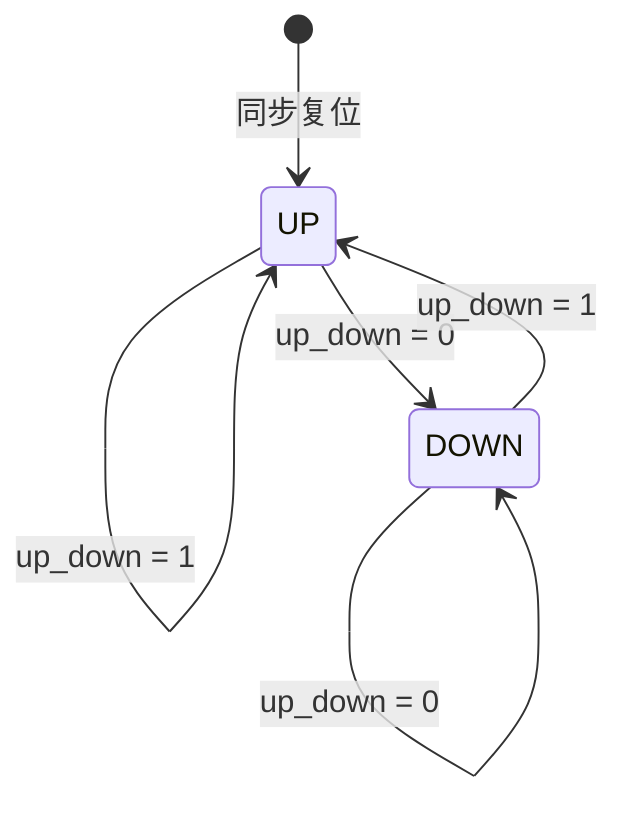

# 第 20 题：4 位可逆计数器的行为级设计、验证与优化分析

沿用 `../temp/` 的 Verilator + GTKWave 仿真框架。按“一段式状态机 → 三段式状态机”的顺序实现，状态为**正计数 UP、反计数 DOWN**，计数器作为独立的数据通路；三段式的第三段负责计数器的同步复位、保持和增减。

## 1. 运行与文件

```sh
cd 720
make sim       # 编译、仿真，生成 build/wave.vcd
make run       # 仿真后打开 GTKWave；直接 make 也执行此目标
make check     # 严格 lint、双仿真器验证、形式等价验证、综合分析
```

| 文件 | 内容 |
| --- | --- |
| [rtl/counter.v](rtl/counter.v) | 一段式：一个时序 always 同时更新方向状态与计数器 |
| [rtl/counter_3stage.v](rtl/counter_3stage.v) | 三段式：方向寄存器、组合次态逻辑、时序计数器 |
| [tb.v](tb.v) | 两版共同的自检查 testbench、定向与穷举激励、覆盖统计 |
| [tb.gtkw](tb.gtkw) | 预置时钟、控制、两版方向状态、次态和计数波形 |
| [equiv.ys](equiv.ys) | Yosys 时序等价验证脚本 |
| [synth.ys](synth.ys) | 两版独立综合与资源统计脚本 |
| [reports/verification.txt](reports/verification.txt) | 本次实际运行的验证摘要 |
| [reports/counter_stat.json](reports/counter_stat.json)、[reports/counter_3stage_stat.json](reports/counter_3stage_stat.json) | 本次综合资源统计 |

基础仿真需要 Verilator 5.x、C++20 编译器和 GNU Make；看波形还需 GTKWave。`make check` 另外使用 Icarus Verilog 和 Yosys。`make sim-iverilog`、`make formal`、`make synth` 可分别运行，`make clean` 只清理 `build/`。

## 2. 接口、状态及功能

| 信号 | 方向/位宽 | 含义 |
| --- | --- | --- |
| `clk` | 输入，1 位 | 上升沿有效 |
| `rst_n` | 输入，1 位 | **低有效同步复位**，上升沿采样为 0 时清零 |
| `en` | 输入，1 位 | 同步计数使能，1 计数、0 保持 |
| `up_down` | 输入，1 位 | 请求方向：1 为 UP，0 为 DOWN；采样后更新方向状态 |
| `count` | 输出，4 位 | 无符号计数值 0～15 |

复位时：`state <= UP`，`count <= 0`。复位优先于使能和方向。正常运行时方向状态可在 `en=0` 时更新，但计数器必须保持。计数器的增减由上升沿前的当前方向状态 `state` 决定；本拍采样的方向请求先更新状态，下一拍的计数使用新方向。

设 `Q` 为上升沿前的计数值，`Q'` 为上升沿后的值：

```text
rst_n = 0                    : Q' = 0，state' = UP
rst_n = 1                    : state' = up_down ? UP : DOWN
rst_n = 1，en = 0            : Q' = Q
rst_n = 1，en = 1，state = UP  : Q' = (Q + 1) mod 16
rst_n = 1，en = 1，state = DOWN: Q' = (Q - 1 + 16) mod 16
```

使用 4 位二进制计数，`15 + 1` 自动截断为 `0`，`0 - 1` 自动截断为 `15`；无需额外的溢出/下溢检测逻辑。

方向控制状态采用 1 位编码：`UP=1'b1`、`DOWN=1'b0`。完整电路还有 4 位计数寄存器，不能把整个电路理解为只有两种数值状态。

| 当前方向状态 | `up_down` | 次态 | `en=1` 时本拍操作 |
| --- | --- | --- | --- |
| UP | 1 | UP | 加 1 |
| UP | 0 | DOWN | 加 1 |
| DOWN | 1 | UP | 减 1 |
| DOWN | 0 | DOWN | 减 1 |



复位在两个方向状态下都有效，图中的初始箭头仅用于表示复位目标。

## 3. 先实现一段式状态机

[counter.v](rtl/counter.v) 只使用一个 `always @(posedge clk)`。同步复位后，按当前方向状态分支，由 `up_down` 决定状态转移，由当前 `state` 决定使能时的计数操作。

所有寄存器更新均使用非阻塞赋值 `<=`。例如当前处于 UP，若本拍采样到 `up_down=0`，则在同一时钟沿执行：

```verilog
state <= DOWN;
if (en)
    count <= count + 4'd1;
```

这一拍按原来的 UP 状态加计数，并将方向状态更新为 DOWN；下一拍才按 DOWN 状态减计数。未使能时省略对 `count` 的赋值，由触发器自然保持。UP 和 DOWN 分支明确分开状态转移和计数动作，便于后续拆分。

## 4. 再拆为三段式状态机

[counter_3stage.v](rtl/counter_3stage.v) 把一段式中的职责拆开：

| 段 | 敏感列表 | 作用 | 赋值 |
| --- | --- | --- | --- |
| 第一段 | `@(posedge clk)` | 同步复位方向状态，或装载 `next_state` | 非阻塞 `<=` |
| 第二段 | `@(*)` | 根据 `state` 和 `up_down` 求方向次态 | 阻塞 `=` |
| 第三段 | `@(posedge clk)` | 同步复位计数器；使能时由当前方向状态 `state` 决定加减 | 非阻塞 `<=` |

第二段先给出 `next_state = state` 的默认赋值，并提供 `default` 分支，避免组合逻辑推导出锁存器。组合逻辑采用阻塞赋值，使次态在本次组合求值中立即计算完成；题目要求的非阻塞赋值用于状态和计数寄存器。

第三段的核心如下：

```verilog
always @(posedge clk) begin
    if (!rst_n)
        count <= 4'd0;
    else if (en) begin
        case (state)
            UP:      count <= count + 4'd1;
            DOWN:    count <= count - 4'd1;
            default: count <= 4'd0;
        endcase
    end
end
```

**第三段由当前 `state` 控制计数方向。** 两个时序块在同一个上升沿读到的都是更新前的寄存器值。第一段的 `state <= next_state` 在非阻塞赋值阶段更新状态，第三段先按沿前 `state` 完成本拍增减；下一上升沿使用更新后的方向状态。一段式也遵循相同的时序关系。

例如初始 `state=UP`、`count=5`，保持 `en=1`，逐拍改变方向请求：

| 上升沿 | 沿前状态 | `up_down` | 沿后状态 | 沿后计数值 |
| --- | --- | --- | --- | --- |
| 第 1 拍 | UP | 0 | DOWN | 6 |
| 第 2 拍 | DOWN | 0 | DOWN | 5 |
| 第 3 拍 | DOWN | 1 | UP | 4 |
| 第 4 拍 | UP | 1 | UP | 5 |

复位后的初始方向为 UP，解除复位后的第一拍也按沿前状态计数。若希望恢复使能时直接反计数，可以先在 `en=0` 时用一个上升沿把方向状态切为 DOWN，再开启计数。本题第三段是**时序数据通路**，计数输出为寄存器输出；一段式和三段式具有相同的方向采样时序。

## 5. Testbench 与验证结果

时钟周期为 10 ns。激励在下降沿修改，避免与 DUT 上升沿采样竞争；参考模型采用整数模 16 运算，每个上升沿后延迟 1 ns，待非阻塞赋值完成，再检查两版计数值和方向状态。

| 场景 | 验证方法 |
| --- | --- |
| 同步复位 | 非零计数时在下降沿拉低复位，确认输出不立即改变，上升沿后才清零 |
| 复位优先级 | 复位同时使能，分别选择两个方向，均应清零并回到 UP |
| 复位保持/释放 | 连续保持复位；释放后分别测试禁止计数和恢复计数 |
| 同步使能 | 禁止时连续保持、切换方向，再重新使能 |
| 上升沿之间的短脉冲 | 插入复位、使能、方向脉冲，在下个采样沿前恢复，计数保持 |
| 加计数及溢出 | 连续正计数 32 拍，覆盖两轮 `0→…→15→0` |
| 减计数及下溢 | 先在禁止计数时切到 DOWN，再连续反计数 32 拍，覆盖两轮 `0→15→…→0` |
| 方向切换 | 检查切换当拍按旧状态、下一拍按新状态计数，明确验证 `5→6→5→4→5` |
| 边界反转 | 验证 `15→0`；暂停并切到 DOWN 后，再验证 `0→15` |
| 完整状态/输入组合 | 穷举 16 个旧计数值 × 2 个旧方向状态 × 8 组控制，共 256 项 |
| 混合序列 | 256 拍可复现伪随机控制，默认种子 119545888 |

穷举时只通过复位和正常计数到达目标值，通过禁止计数时切换方向准备旧方向状态，不使用 `force` 或直接修改 DUT 寄存器。覆盖位图在实际采样的上升沿记录旧状态和输入，结束时检查全部 256 项均已命中；任一比较或覆盖检查失败都执行 `$fatal(1, ...)`。

实际验证结果：

```text
PASS: both FSMs match the model, cycles=3121 count_values=16/16 combinations=256/256 seed=119545888
COVER: reset=412 hold=449 up=2121 down=139 overflow=16 underflow=19
```

其中复位、保持、正计数、反计数四项相加为 3121 拍，回绕事件另外统计；正反计数和回绕均按沿前的方向状态判定。Verilator 与 Icarus Verilog 得到相同结果，严格 lint 无警告。形式等价验证最终输出 `Equivalence successfully proven!`，4 位计数输出与 1 位方向状态共 5 项全部通过证明。等价证明用于比较两种实现；功能正确性同时由独立参考模型和上述场景检查。

波形保存在 `build/wave.vcd`，`make wave` 可查看。正计数时关注 `count: e,f,0,1`，反计数时关注 `count: 1,0,f,e`；改变方向后，`next_state` 可在时钟沿前变化，`state` 和 `count` 只在上升沿更新。

可以用 `make sim ARGS="+SEED=123"` 改变混合序列种子，定向与穷举部分保持不变。种子 0 会转换为 1，以避免 xorshift 进入全零序列。

## 6. 综合结果与优化分析

使用 Yosys 的通用 `synth` 流程分别综合两个模块，不指定器件或工艺库。工具版本和原始资源统计保存在 `reports/`，完整日志、门级网表和最新统计由 `make synth` 生成到 `build/`。

| 指标 | 一段式 | 三段式 |
| --- | ---: | ---: |
| RTL 显式寄存器位数：方向 1 位 + 计数 4 位 | 5 | 5 |
| 综合后计数触发器 | 4 | 4 |
| 综合后保留的方向触发器 | 1 | 1 |
| 通用组合逻辑单元 | 16 | 13 |
| 总单元数 | 21 | 18 |
| 锁存器 | 0 | 0 |

两版的 4 个计数触发器均为 Yosys 的 `$_SDFFE_PN0P_` 单元，表示正沿触发、低有效同步清零、正使能；方向触发器为 `$_SDFF_PN1_`，表示正沿触发、低有效同步置 1，对应复位回到 UP。两版均符合接口要求。

**状态逻辑优化。** 两个方向状态对相同 `up_down` 总是给出相同次态，在合法二值状态下组合转移逻辑可化简为 `next_state = up_down`。计数器使用当前 `state`，需要保存已经采样的方向，因此方向寄存器保留；两版均为 1 位方向存储加 4 位计数存储。RTL 保留显式两状态 FSM，便于展示一段式和三段式组织。

**计数逻辑优化。** 使用最小的 4 位计数寄存器和 `4'd1` 定宽常量，利用截断实现模 16 回绕，省去边界比较器。综合器会将固定的加/减 1 化简为位翻转与进位/借位逻辑，无需手写门级全加器。也可尝试将步长写成 `state == UP ? 4'd1 : 4'hf` 后统一相加，再以同一套验证和目标器件综合结果评估；本次没有把这种写法当作已测得的面积或速度改进。

**结构优化。** 三段式把方向控制和计数数据通路分离，便于扩展暂停、装载等功能。本次相同综合流程中，组合单元从一段式的 16 个降为三段式的 13 个，总单元数由 21 个降为 18 个。这是当前代码和综合优化流程的实际结果，不能泛化为所有三段式都会节省硬件，也不能直接换算为物理面积或时序收益。两个方向状态采用 1 位二进制编码已经足够，无需改为独热码。

**时序与功耗。** 计数数据通路从计数/方向寄存器输出，经当前状态控制的增减组合逻辑，回到计数寄存器输入；`up_down` 先进入方向寄存器，在下一拍影响计数。同步使能使 `en=0` 时计数寄存器保持；这里未测量功耗，不把保持行为直接换算为功耗降幅。应继续使用同步使能，避免通过 `clk & en` 人工门控时钟。实际最高频率、LUT/标准单元面积和功耗，需要指定 FPGA 或标准单元库、时钟约束后再评估；本次 100 MHz 是 testbench 的激励频率，不是已经收敛的硬件工作频率。
