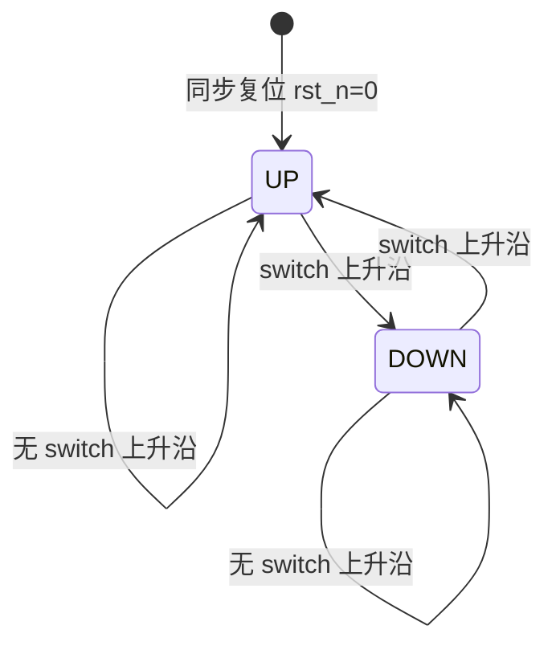

# 第 20 题：4 位可逆计数器的行为级设计、验证与优化分析

沿用 `../temp/` 的 Verilator + GTKWave 仿真框架。按“一段式状态机 → 三段式状态机”的顺序实现，保留**正计数 UP、倒计数 DOWN** 两个状态；`switch` 每次被时钟采样到上升沿时切换方向，复位恢复 UP 并清零计数。

## 1. 运行与文件

```sh
cd 720
make sim       # 编译、仿真，生成 build/wave.vcd
make run       # 仿真后打开 GTKWave；直接 make 也执行此目标
make check     # 严格 lint、双仿真器验证、形式等价验证、综合分析
```

| 文件 | 内容 |
| --- | --- |
| [rtl/counter.v](rtl/counter.v) | 一段式：同一时序块更新方向、switch 历史采样和计数器 |
| [rtl/counter_3stage.v](rtl/counter_3stage.v) | 三段式：方向寄存器、组合次态逻辑、时序计数器 |
| [rtl/counter_3stage.svg](rtl/counter_3stage.svg) | 与当前 RTL 对应的状态转移图 |
| [tb.v](tb.v) | 两版共同的自检查 testbench、定向与穷举激励、覆盖统计 |
| [tb.gtkw](tb.gtkw) | 时钟、switch、沿检测、两版方向状态、次态和计数波形 |
| [equiv.ys](equiv.ys) | Yosys 时序等价验证脚本 |
| [synth.ys](synth.ys) | 两版独立综合与资源统计脚本 |
| [reports/verification.txt](reports/verification.txt) | 本次实际运行的验证摘要 |
| [reports/counter_stat.json](reports/counter_stat.json)、[reports/counter_3stage_stat.json](reports/counter_3stage_stat.json) | 本次综合资源统计 |

基础仿真需要 Verilator 5.x、C++20 编译器和 GNU Make；看波形还需 GTKWave。`make check` 另外使用 Icarus Verilog 和 Yosys。`make sim-iverilog`、`make formal`、`make synth` 可分别运行，`make clean` 清理 `build/`。

## 2. 接口、状态及功能

| 信号 | 方向/位宽 | 含义 |
| --- | --- | --- |
| `clk` | 输入，1 位 | 上升沿有效 |
| `rst_n` | 输入，1 位 | 低有效同步复位，采样为 0 时回到 UP，计数和 switch 历史清零 |
| `switch` | 输入，1 位 | 替代原 `up_down`；每次采样到 0→1 时切换 UP / DOWN |
| `en` | 输入，1 位 | 同步计数使能，1 计数、0 保持；不限制方向切换 |
| `count` | 输出，4 位 | 无符号计数值 0～15 |

方向编码为 `UP=1'b1`、`DOWN=1'b0`。计数器作为独立数据通路，方向由沿前的当前状态决定。

```verilog
reg switch_d;
wire switch_rise = switch && !switch_d;
```

`switch_d` 保存上一次时钟采样值，正常运行时每拍执行 `switch_d <= switch`。当旧采样为 0、本拍为 1 时，`switch_rise` 使状态翻转一次。持续高电平、持续低电平和下降沿均保持方向。全部寄存器仍由 `posedge clk` 驱动。

复位优先于沿检测和计数使能：`state <= UP`、`switch_d <= 0`、`count <= 0`。由于历史采样复位为 0，释放复位后的首次采样若 `switch=1`，会识别为一次上升沿并切到 DOWN；若希望释放后保持 UP，应先令 `switch=0`。

| 当前方向 | `switch_rise` | 次态 | `en=1` 时本拍操作 |
| --- | --- | --- | --- |
| UP | 0 | UP | 加 1 |
| UP | 1 | DOWN | 加 1 |
| DOWN | 0 | DOWN | 减 1 |
| DOWN | 1 | UP | 减 1 |



复位在两个方向状态下都有效。计数为模 16 运算，`15+1` 回绕到 `0`，`0-1` 回绕到 `15`。这里的沿检测针对相邻时钟采样；两个采样沿之间未被采到的短脉冲不触发方向切换。

## 3. 一段式与三段式

[counter.v](rtl/counter.v) 用一个时序 `always` 同时更新方向、switch 历史采样与计数。UP / DOWN 分支中，`switch_rise` 决定是否切换方向，`en` 决定是否计数。

[counter_3stage.v](rtl/counter_3stage.v) 保留原来的三段式组织与 `count_up` / `count_down` 组合数据通路：

| 段 | 敏感列表 | 作用 | 赋值 |
| --- | --- | --- | --- |
| 第一段 | `@(posedge clk)` | 复位或更新方向状态及 switch 历史采样 | 非阻塞 `<=` |
| 第二段 | `@(*)` | 根据 `state` 和 `switch_rise` 求方向次态 | 阻塞 `=` |
| 第三段 | `@(posedge clk)` | 同步复位计数器；使能时按当前 `state` 增减 | 非阻塞 `<=` |

第二段先给出 `next_state = state` 的默认赋值，无上升沿时自然保持，并提供 `default: next_state = UP`。时序块都使用非阻塞赋值，因此**切换当拍按旧方向计数，下一拍按新方向计数**。

例如初始 UP、计数值 5：

| 时钟上升沿 | 沿前方向 | `switch` 上一拍→本拍 | `en` | 沿后方向 | 沿后计数值 |
| --- | --- | --- | --- | --- | --- |
| 1 | UP | 0→1 | 1 | DOWN | 6 |
| 2 | DOWN | 1→1 | 1 | DOWN | 5 |
| 3 | DOWN | 1→0 | 0 | DOWN | 5 |
| 4 | DOWN | 0→1 | 1 | UP | 4 |
| 5 | UP | 1→1 | 1 | UP | 5 |

## 4. 验证结果

时钟周期为 10 ns，输入在下降沿修改。独立参考模型使用整数模 16 运算，并记录上一次 switch 样本；每个上升沿后延迟 1 ns，检查两版计数、方向状态和历史采样。

验证包含：同步复位及复位优先、长高电平仅切换一次、下降沿不切换、暂停计数时切换方向、沿间短脉冲、连续正反计数、上下溢，以及切换当拍使用旧方向。穷举通过正常输入准备寄存器，不使用 `force` 或层次赋值，覆盖 `16 个计数值 × 2 个方向 × 2 个 switch 历史值 × 8 组输入 = 512` 项。

本次 `make check` 通过：严格 lint 无警告，Icarus Verilog 与 Verilator 仿真结果一致，形式等价验证及综合检查通过。

```text
PASS: both FSMs match the model, cycles=6765 count_values=16/16 combinations=512/512 seed=119545888
COVER: reset=790 hold=1808 up=4004 down=163 toggles=904 overflow=11 underflow=19
```

等价验证共 7 项通过：4 位计数输出、1 位方向状态、1 位 switch 历史采样与沿检测信号。功能正确性由独立参考模型及定向场景共同检查。波形保存在 `build/wave.vcd`，`make wave` 可查看。

## 5. 综合与优化分析

| 实现 | 总通用单元 | 触发器 | 组合单元 | 锁存器 |
| --- | --- | --- | --- | --- |
| 一段式 `counter` | 24 | 6 | 18 | 0 |
| 三段式 `counter_3stage` | 21 | 6 | 15 | 0 |

每版存储为 4 位计数、1 位方向、1 位 switch 历史。合法二值状态下转移逻辑可化简为 `next_state = state ^ switch_rise`；RTL 保留显式 UP / DOWN 分支，便于展示两种状态机组织。4 位定宽加减利用截断实现回绕，无需边界比较器。

资源数来自当前代码的 Yosys 通用门级综合，不代表具体器件的物理面积、时序或功耗。方向与计数保持同步更新，`en=0` 时使用寄存器使能保持计数；仿真的 100 MHz 激励频率不代表已完成硬件时序收敛。
