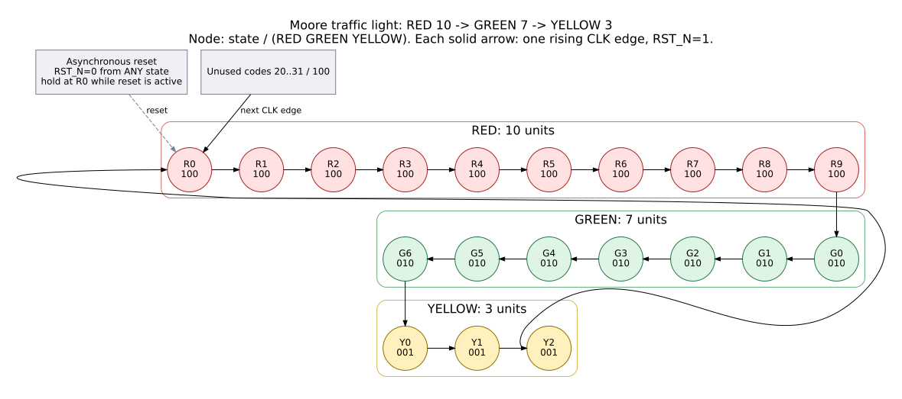

# 第 20 题：Moore 型交通灯控制器

**题目：** 用 Moore 型状态机设计一个交通灯控制器，要求红灯亮 10 个时间单位、绿灯亮 7 个时间单位、黄灯亮 3 个时间单位，并画出完整的状态转移图。

## 设计思路

规定 **1 个时钟周期为 1 个时间单位**，按“红 → 绿 → 黄 → 红”循环，周期为 `10 + 7 + 3 = 20` 个时间单位。若实际需要每个单位为 1 秒，应向控制器提供周期为 1 秒的时钟；本工程仿真用 10 ns 周期表示一个单位。

Moore 型状态机的输出仅由**当前状态**决定。这里将每个时间单位展开为一个状态，共使用 20 个状态：红灯 `R0～R9`、绿灯 `G0～G6`、黄灯 `Y0～Y2`。每个状态停留 1 拍，因此三种灯分别连续亮 10、7、3 拍，无需另外设置计数器。状态寄存器需要 `ceil(log2(20)) = 5` 位。

输入为上升沿时钟 `CLK` 和低有效异步复位 `RST_N`；输出 `RED`、`GREEN`、`YELLOW` 均为高有效。复位从任意状态进入 `R0`，保持复位时一直亮红灯。正常计时以时钟边沿为界，复位保持期间不计入正常循环；异步解除复位到下一上升沿的间隔不保证为完整一拍。

设当前状态为 `Q`，输出顺序为 `(RED, GREEN, YELLOW)`：

```text
Q ∈ {R0, R1, …, R9}  → 输出 100
Q ∈ {G0, G1, …, G6}  → 输出 010
Q ∈ {Y0, Y1, Y2}     → 输出 001
```

例如 `R9 → G0` 的上升沿后，当前状态成为 `G0`，输出立即译码为绿灯；输出不再额外寄存一拍。

## 完整状态转移图

图中**每条正常转移箭头表示一个时钟上升沿**，条件均为 `RST_N=1`；节点第二行为输出 `RED GREEN YELLOW`。所有 20 个正常状态均已展开，虚线表示任意状态下的异步复位。未用编码也给出恢复路径。



为便于阅读，正常循环也可按下面三行查看，所有相邻状态均只间隔 1 拍：

```text
红灯段：R0/100 → R1/100 → R2/100 → R3/100 → R4/100 → R5/100 → R6/100 → R7/100 → R8/100 → R9/100 → G0
绿灯段：G0/010 → G1/010 → G2/010 → G3/010 → G4/010 → G5/010 → G6/010 → Y0
黄灯段：Y0/001 → Y1/001 → Y2/001 → R0（循环）
```

## 状态编码及转移表

下表为 `RST_N=1` 时每个上升沿的转移；`RST_N=0` 时优先异步回到 `R0`。

| 当前状态 | 5 位编码 | 输出 RGY | 次态 |
| --- | --- | --- | --- |
| R0 | 00000 | 100 | R1 |
| R1 | 00001 | 100 | R2 |
| R2 | 00010 | 100 | R3 |
| R3 | 00011 | 100 | R4 |
| R4 | 00100 | 100 | R5 |
| R5 | 00101 | 100 | R6 |
| R6 | 00110 | 100 | R7 |
| R7 | 00111 | 100 | R8 |
| R8 | 01000 | 100 | R9 |
| R9 | 01001 | 100 | G0 |
| G0 | 01010 | 010 | G1 |
| G1 | 01011 | 010 | G2 |
| G2 | 01100 | 010 | G3 |
| G3 | 01101 | 010 | G4 |
| G4 | 01110 | 010 | G5 |
| G5 | 01111 | 010 | G6 |
| G6 | 10000 | 010 | Y0 |
| Y0 | 10001 | 001 | Y1 |
| Y1 | 10010 | 001 | Y2 |
| Y2 | 10011 | 001 | R0 |
| 未用状态 | 10100～11111 | 100 | R0 |

## Verilog 实现与运行

[rtl/traffic_light.v](rtl/traffic_light.v) 分为状态寄存器、组合次态逻辑、组合 Moore 输出译码三个部分。时序逻辑使用非阻塞赋值 `<=`，组合逻辑使用阻塞赋值 `=`；输出完整赋值，避免锁存器。

```sh
cd 920
make sim        # Verilator 编译和自检查仿真，生成 build/wave.vcd
make run        # 仿真后打开 GTKWave；直接 make 也执行此目标
make wave       # 查看现有波形
make check      # 严格 lint、Icarus 仿真、Verilator 仿真
make diagram    # 使用 Graphviz 从 .dot 重新生成 .svg 状态图
```

`tb.gtkw` 预置时钟、复位、三个灯输出、当前状态及次态。正常波形中 `RED` 连续为高 10 拍，随后 `GREEN` 高 7 拍、`YELLOW` 高 3 拍，再循环。

[tb.v](tb.v) 用独立的模 20 时间轴逐拍比较输出，验证四个完整周期的亮灯时长、循环顺序、三灯互斥，并分别在红、绿、黄阶段中途异步复位，再验证重新开始的时序。比较等待非阻塞赋值完成，失败使用 `$fatal` 返回非零退出码。

实际执行 `make check`：Verilator 严格 lint 无警告，Icarus Verilog 和 Verilator 均通过，结果一致：

```text
PERIODS: 4 x (red=10, green=7, yellow=3), total R/G/Y=40/28/12
PASS: ticks=195 resets=4; sequence, durations and asynchronous reset verified
```
